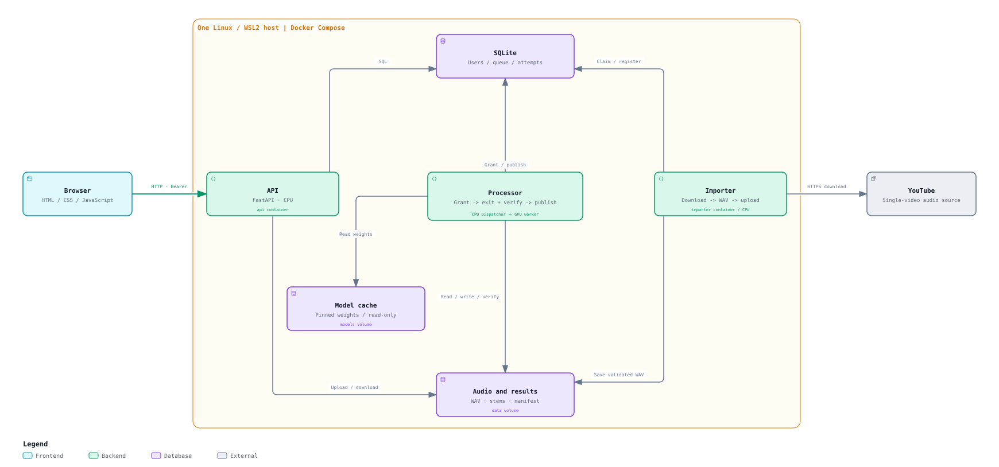

# IsoJam

[](https://github.com/Ian0520/isojam/actions/workflows/backend.yml)

**Turn songs into practice tracks.** Upload a WAV, MP3, M4A, AAC or FLAC recording,
or paste a YouTube video link. Separate its instruments with BS-RoFormer, then
preview or download the tracks in your browser.

IsoJam runs on one Linux host, locally or in a verified private AWS deployment,
with a CPU API, a CPU audio importer and a separate NVIDIA GPU processor. It uses
Python, FastAPI, SQLAlchemy, SQLite and Docker Compose. Accounts, recordings and
results persist across container replacements.


Current interface with synthetic preview data. See the
[recorded real-GPU demo and verification evidence](docs/demo.md) for processing
checks; the recording shows an earlier interface.

For a private, start/stop GPU host on AWS, see the
[AWS test deployment guide](docs/aws-test-deployment.md), including setup,
graceful shutdown and recorded verification results.

## Start locally with Docker Compose

This is the recommended setup for personal use. All commands below run in a
Linux terminal, or **Ubuntu/WSL2 on Windows**, from the repository root.
The application and inference dependencies run inside containers; no host Python
virtual environment is required. Host `python3` is used only to generate a secret.

### 1. Check prerequisites

You need a Linux x86_64 Docker engine, Docker Compose with GPU support, and a
compatible NVIDIA GPU/host driver. The GPU image supplies PyTorch and CUDA user
libraries; the host supplies the driver. The current lock targets CUDA 13.0.
The [local stack guide](docs/local-stack.md#host-requirements) explains the runtime
requirements and the hardware used for verification.

On Windows, start Docker Desktop with its WSL2 backend and Ubuntu integration.
Keep Docker Desktop running, open Ubuntu, and check:

```bash
docker version
docker compose version
```

`docker version` must show both **Client** and **Server**. Allow space for the
large GPU image, build cache, model checkpoint and generated WAV files. Under
WSL, check free space on the Windows drive as well as inside Linux:

```bash
df -h / /mnt/c
```

For a new checkout:

```bash
git clone https://github.com/Ian0520/isojam.git
cd isojam
```

If you already have the repository, use that checkout instead. Keep the remaining
commands in the directory containing `compose.yaml`.

### 2. Configure local settings once

```bash
cp -n .env.example .env
python3 -c "import secrets; print(secrets.token_hex(32))"
```

Open `.env` in an editor, for example `nano .env`, and paste the generated value
after `ISOJAM_JWT_SECRET_KEY=`. In nano, save with Ctrl+O, Enter, then exit with
Ctrl+X. Keep this secret stable across restarts. The copy command preserves an
existing `.env`; do not replace an existing secret as part of daily startup.
Git ignores `.env`.

The example explicitly sets `ISOJAM_REGISTRATION_MODE=open` so you can create
your local account. No invitation is needed. The application default is `closed`;
see [registration configuration](docs/configuration.md#configure-registration)
for closed and invitation-only operation.

### 3. Build images and prepare the model once

```bash
docker compose build
docker compose run --rm models
```

The build installs the locked API, GPU and CPU importer dependencies. The model command
prepares and verifies assets in a persistent Docker volume; it reuses valid
cached assets when repeated. The host's native model cache is separate.

### 4. Start IsoJam

```bash
docker compose up --abort-on-container-failure
```

Compose applies database migrations, starts the processor and CPU importer, waits
for their readiness checks, then starts the API. Logs remain visible in this terminal.
An exited `migrate` service with code 0 is expected.

Open **[http://localhost:8000](http://localhost:8000)**. The port is bound to your
own machine. API documentation is at [http://localhost:8000/docs](http://localhost:8000/docs).
If you changed `ISOJAM_PORT` in `.env`, use that port instead.

### 5. Create an account and try a recording

1. Select **Create account**, enter your email and password, then submit.
   Successful registration signs you in automatically. If automatic sign-in
   fails after account creation, use **Sign in** with those credentials.
2. Choose a short WAV, MP3, M4A, AAC or FLAC file and select **Separate audio**.
   Defaults allow up to 200 MiB and 10 minutes of readable mono or stereo audio.
   The API converts the additional formats to WAV before queuing separation;
   converted files have a separate 256 MiB limit. FFmpeg is included in the API image.
3. The upload form collapses and the recording moves through queued/processing
   to completed. The model loads in the processor's worker for each job.
4. Use **Preview** to listen to an individual track or **Download** to save its
   WAV. Outputs are vocals, drums, bass, guitar, piano, other and instrumental.
5. Reopen previous work from **Recent recordings**. **Load more** retrieves the
   next history page; **Refresh** returns to the newest page. **Details** contains
   the job ID, and **Find by job ID** opens an owned recording directly.

For a YouTube source, select **YouTube link**, paste one non-live video URL and
select **Separate audio**. IsoJam first downloads and prepares the audio, then
queues instrument separation. If you leave during preparation, return and sign
in to continue; once separation is queued, it continues in the background.
**Recent YouTube imports** lets you resume prepared audio or reopen its recording
without downloading it again. See the [import workflow](docs/youtube-imports.md)
for supported links, limits and recovery behavior.

This Compose stack uses its own data volume. It does not import accounts or
recordings from an earlier native Python environment or a manual Docker exercise.

## Daily startup, shutdown and updates

After the one-time setup, start from the repository root:

```bash
docker compose up --abort-on-container-failure
```

Press **Ctrl+C once** to stop. Let shutdown finish: the API stops accepting
requests, and the processor finishes its active cycle before exiting. Pending
work stays queued for the next startup. Normal shutdown preserves accounts,
recordings, outputs and cached models.

The importer also finishes its current download/conversion before stopping,
with a three-minute stop grace. Its [API workflow and recovery behavior](docs/youtube-imports.md)
are documented in the [YouTube import guide](docs/youtube-imports.md).

From another terminal, these commands also preserve the named volumes:

```bash
# Stop and keep the containers.
docker compose stop

# Or stop and remove containers and the network.
docker compose down
```

After changing source code or updating the checkout, stop first, then rebuild:

```bash
docker compose stop
docker compose up --build --abort-on-container-failure
```

This also gives a future migration exclusive access while services are stopped.
Changing `.env` requires container recreation; starting an old container alone
does not apply new settings or source. The [local stack guide](docs/local-stack.md)
covers background startup, storage, graceful shutdown and model maintenance.

`docker compose down --volumes` **deletes the database, recordings, outputs and
cached model assets**. Use ordinary `stop` or `down` for daily operation.
Persistent volumes survive replacements, but there is no automatic backup policy.

## Troubleshooting

Start with:

```bash
docker compose ps -a
docker compose logs --tail 100 migrate processor api
```

| Symptom | Next step |
| --- | --- |
| Docker is missing or cannot connect to the engine | Start Docker Desktop and check Ubuntu WSL integration; `docker version` must report a server. |
| Compose asks for a JWT secret | Complete the `.env` setup above. Keep its value stable. |
| Processor reports missing model files | Stop the stack, run `docker compose run --rm models`, then start again. |
| Processor cannot access CUDA | Check Docker GPU access and the host NVIDIA driver; installing Python packages on the host does not fix container GPU access. |
| Port 8000 is already allocated | Stop the other service, or change `ISOJAM_PORT` in `.env` and recreate the containers. |
| Create account is unavailable | Check the registration mode. Set it to `open` for local signup, recreate the API, and reload the page. |
| A recording remains queued | Inspect processor logs and the current attempt. Do not force retries of uncertain execution. |
| Sign-in expired | Sign in again and reopen the recording from history. Tokens expire after 30 minutes. |
| Page looks outdated or reports a missing element | Rebuild after source changes, then reload. Ctrl+Shift+R clears older cached assets from before the cache-policy fix. |

See [operations and troubleshooting](docs/operations.md) for upload failures,
queue recovery, storage and diagnostic commands.

## How it works



See the [architecture diagrams](docs/architecture/README.md) for the verified
private AWS deployment, runtime components, job execution sequence and complete
database ERD, with larger-text HTML views for presentation.

The API accepts durable queued jobs without loading the model. The dispatcher
runs one attempt at a time on this host. Execution permission, heartbeats and
confirmed worker exit distinguish running, stopped and uncertain work. The
processor verifies all seven saved outputs before publishing completion and
output records in one database transaction. Saved results can be published after
a restart without repeating inference when the required stop proof is available.
See the [worker guide](docs/model-worker.md) for recovery boundaries.

Accounts use Argon2 password hashing and JWT access tokens. Uploads and downloads
are owner-scoped. Submission receipts support idempotent retries, and upload,
audio-duration and per-user unfinished-job limits bound admission.

## Alternative development setups

The Compose workflow above selects `queued` mode and starts its processor for
you. Other setups are available for development and focused exercises:

| Mode | Use | Setup |
| --- | --- | --- |
| `queued` | Separate API and same-host real model dispatcher; also the Compose default. | [Compose](docs/local-stack.md) or [native worker](docs/model-worker.md). |
| `local` | Native Python API with an in-process model session and background tasks. Interrupted inference is not resumed after restart. | [Native Python setup](docs/configuration.md#setup). |
| `disabled` | CPU API, authentication, uploads and existing-result access. New separation requests return 503. | [Manual CPU container](docs/containers.md). |

The standalone CPU image defaults to `disabled`. Compose explicitly overrides it
to `queued`. Real queued work uses `local-model`; `local-fake` generates dummy
WAVs only for coordination tests. Queued mode itself does not imply fake audio.

## Verify without a GPU

With a running Linux Docker engine, from the repository root:

```bash
docker build --platform linux/amd64 -t isojam-api:ci backend
python3 backend/scripts/check_container.py --image isojam-api:ci
```

This checks lint, formatting and the Python suite with locked tools in a
disposable container as the runtime user. GitHub Actions also checks browser
JavaScript and runs authentication/upload/history tests and HTTP/container lifecycle
smokes. The [CI guide](docs/ci.md#run-the-same-checks-locally) lists the complete
commands. CPU checks use explicit test workers; real GPU verification is recorded
separately in the [local stack guide](docs/local-stack.md#verification-recorded-on-2026-10-18).

## Scope and limitations

This version runs on one local Linux/WSL host with an NVIDIA GPU, shared SQLite
and local audio storage. It is not publicly hosted. Remote GPU control/storage,
MySQL and Redis integration remain future work. There is no automatic audio
retention or backup policy.

Browser access tokens are tab-scoped, expire after 30 minutes and have no refresh
flow. Preview downloads the whole authenticated WAV before playback. Custom
backing-track mixing, looping and speed adjustment are not implemented.
The browser accepts local audio files and single-video YouTube links. Live videos,
playlists and arbitrary website URLs are unsupported. Download availability depends
on YouTube and the pinned downloader; the [import guide](docs/youtube-imports.md)
describes failures and manual checks.

The queue favors avoiding duplicate execution when a worker's exit is uncertain.
Automatic inference retry of uncertain attempts is not supported. A successful
health response proves HTTP availability, not that a job can finish.

## Further reading

- [System architecture, job execution and database schema](docs/architecture/README.md)
- [Local stack operation and model cache](docs/local-stack.md)
- [Configuration and API reference; alternative native setup](docs/configuration.md)
- [Registration invitations](docs/invitations.md)
- [Operations and troubleshooting](docs/operations.md)
- [Current interface, recorded demo and verification evidence](docs/demo.md)
- [Continuous integration](docs/ci.md)
- [Manual CPU container exercise](docs/containers.md)
- [Worker design](docs/worker-design.md) and [real model worker](docs/model-worker.md)
- [Design notes and tradeoffs](docs/design-notes.md)
- [Original model compatibility spike](docs/model-spike.md)
- [Product direction](docs/project-scope.md)
