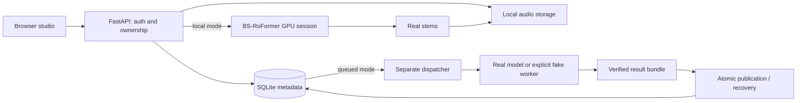

# IsoJam

[](https://github.com/Ian0520/isojam/actions/workflows/backend.yml)

**Turn songs into practice tracks.** Upload a WAV recording, separate its
instruments with BS-RoFormer, then preview or download the stems in a browser.

IsoJam is a backend-focused personal project built with Python, FastAPI,
SQLAlchemy, SQLite and a pretrained audio model. It includes a working local GPU
demo and a separate queued worker with durable execution and publication records.


[Watch the 14-second local demo](docs/demo/real-separation.webm) ·
[Demo and verification evidence](docs/demo.md) ·
[Setup and API guide](docs/configuration.md) ·
[Container guide](docs/containers.md) ·
[Local GPU stack](docs/local-stack.md)

## What works

- Account registration with open, closed and invitation-only modes, Argon2 password hashing and JWT login.
- Authenticated WAV uploads with request, file-size, duration and decoded-audio validation.
- Ownership checks on uploads, jobs and stem downloads.
- Owner-scoped job-history API with cursor pagination and original filenames.
- Browser history with recent sessions, refresh, pagination and one-click reopening.
- Browser submission, status polling, session restoration by job ID, playback and downloads.
- Seven outputs: vocals, drums, bass, guitar, piano, other and instrumental.
- Persistent metadata with Alembic migrations, per-user unfinished-job limits and idempotent job submission.
- A non-root CPU API container with hash-locked dependencies and persistent storage.
- A separate GPU processor image and Compose stack for local startup, draining shutdown and persistent data/model volumes.
- A separate queued real-model worker with execution authorization, heartbeats, verified result bundles, atomic publication and restart reconciliation.
- An explicit fake worker for CPU-only coordination and container checks.
- GitHub Actions covering lint, formatting, tests, container packaging and interrupted-publication recovery.

## Two processing paths

| Path | Purpose | Execution and recovery |
| --- | --- | --- |
| `local` | Real source separation in the browser | Loads the GPU model once; runs FastAPI background tasks. Interrupted inference is not resumed after restart. |
| `queued` | Separate worker execution | A continuous Linux dispatcher runs the real model with `local-model`, or test WAVs with explicit `local-fake`. Saved results can be published after confirmed exit without repeating inference. |
| `disabled` | CPU API and existing-result access | Authentication, uploads, status and downloads work; new jobs return 503. |

The CPU Docker image defaults to `disabled` and does **not** contain the model.
Real queued inference runs in the existing CUDA environment or the separate
[GPU processor container](docs/local-stack.md) on the SQLite host.
See [Real model worker](docs/model-worker.md). An unknown worker exit keeps its
queue slot occupied; an old heartbeat alone is not enough to authorize replacement.

With matching database/audio settings and the API in queued mode, start its worker
from the activated inference environment:

```bash
python -m app.dispatcher --serve --adapter local-model
```

Use `--once` for a single cycle. SIGTERM or Ctrl+C stops the continuous dispatcher
after its active cycle finishes. An example supervised service and the disposable
real GPU restart/interruption smoke are documented in the worker guide.



## Try the local GPU demo

For the containerized API and GPU processor, follow the
[local Compose setup](docs/local-stack.md#first-setup). After building both images
and preparing model assets, `docker compose up --abort-on-container-failure`
starts the stack; Ctrl+C drains its active job and preserves the volumes.

Use Ubuntu/WSL2, Python 3.12 and the existing CUDA inference environment.
Follow the [setup guide](docs/configuration.md#setup) to install the inference
extra, configure a signing secret and apply migrations. Then, from `backend`:

```bash
source .venv/bin/activate
export ISOJAM_PROCESSING_MODE=local
export ISOJAM_REGISTRATION_MODE=open
uvicorn app.main:app --host 127.0.0.1 --port 8000
```

Open [http://127.0.0.1:8000/](http://127.0.0.1:8000/), create an account, choose a
short WAV and select **Separate audio**. Return to previous work through **Your
sessions**; saved job IDs also work through the expandable lookup. API documentation
is at `/docs`. See the [demo guide](docs/demo.md) for
prerequisites and the tested workflow.

Registration defaults to `closed`. The demo explicitly opens it for account
creation; set it back to `closed` and restart to stop new signups while existing
accounts can still log in. Set `invite` to require an email-bound code through
the browser's **Create account** form or the API. See the
[registration policy](docs/configuration.md#configure-registration).

## Verify without a GPU

With a running Linux Docker engine, from the repository root:

```bash
docker build --platform linux/amd64 -t isojam-api:ci backend
python3 backend/scripts/check_container.py --image isojam-api:ci
python3 backend/scripts/smoke_container.py --image isojam-api:ci
python3 backend/scripts/smoke_container.py --image isojam-api:ci --processing-mode queued --dispatch-fake-worker --recover-publication
```

The checks use disposable databases, audio directories and Docker resources.
They test the installed CPU image and preserve existing project data. These
checks use fake model sessions; the real GPU browser flow is validated separately.

See [CI](docs/ci.md) for workflow details and [containers](docs/containers.md) for
manual operation with your own persistent volume.

## Scope and limitations

This is a working local demo and tested backend, not a public hosted service.
Metadata is SQLite and audio is local storage. The browser uses tab-scoped access
tokens, which expire after 30 minutes; refresh tokens are not implemented.
Preview fetches a whole authenticated WAV before playing it.

Local inference has no global GPU scheduling limit or restart recovery. The
queued path uses one global slot with continuous polling or explicit cycles. Known
nonzero exits without a manifest can be finalized as failed; uncertain execution
and damaged saved manifests require inspection. AWS hosting, remote GPU execution, MySQL and Redis
integration remain future work. Custom backing-track mixing and speed adjustment
are not yet implemented.

## Explore the project

- [Configuration and API reference](docs/configuration.md)
- [Registration invitations](docs/invitations.md)
- [Docker operation and smoke tests](docs/containers.md)
- [Continuous integration](docs/ci.md)
- [Demo recording and measured evidence](docs/demo.md)
- [Operations and troubleshooting](docs/operations.md)
- [Design notes and tradeoffs](docs/design-notes.md)
- [Worker design](docs/worker-design.md)
- [Real queued model worker](docs/model-worker.md)
- [Original model compatibility spike](docs/model-spike.md)
- [Product direction](docs/project-scope.md)
