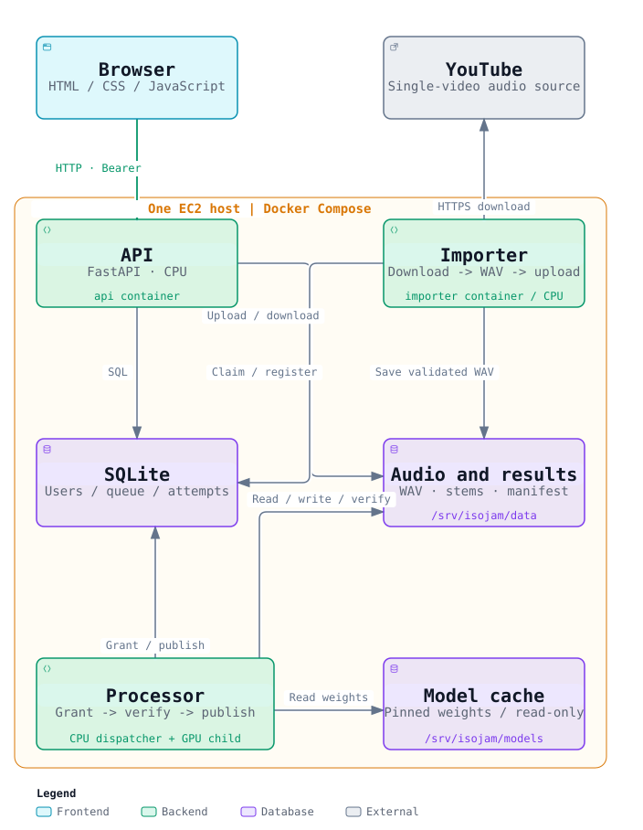

# Architecture

These diagrams describe IsoJam's implemented, single-host `queued` mode and its
verified private AWS deployment in Sydney (`ap-southeast-2`). The API, CPU audio
importer and GPU processor run as separate Docker Compose services on one EC2
host. Public HTTPS and multi-host operation are not implemented.

## AWS deployment overview


The owner opens the application through an AWS Systems Manager Session Manager
port-forwarding tunnel: laptop `localhost:8001` reaches host port `8000`.
The security group has no inbound rules; the SSM Agent establishes an outbound
control channel using the instance profile.

A `g4dn.xlarge` instance supplies one NVIDIA T4 GPU. Its encrypted, retained
100 GB gp3 EBS volume holds Docker state, SQLite, audio and model assets.
The AWS Compose override bind-mounts `/srv/isojam/data` and `/srv/isojam/models`;
the processor mounts the model cache read-only. systemd manages startup and
graceful draining before EC2 stop. The boot deadline is 120 minutes, and
application startup is explicit for each testing session.

The [2026-10-21 verification record](../aws-test-deployment.md#first-private-aws-run-on-2026-10-21)
confirms real GPU inference, idempotent submission, seven authenticated track
downloads, preservation across EC2 stop/start and graceful shutdown. The latest
AWS inspection on that date found the instance stopped. The timer's shutdown
action was tested manually; the test did not wait for the two-hour deadline.
A synthetic-audio smoke does not establish music quality or multi-user capacity.
EBS storage remains allocated while the instance is stopped.

[Large-text HTML](system-overview-readable.html) ·
[Interactive Archify reader](system-overview.html) ·
[Editable source](sources/system-overview.architecture.json)

## Runtime components



The API commits accepted work to SQLite. The importer prepares YouTube audio;
the processor discovers separation jobs in the database and runs one inference
at a time. The API does not call a remote GPU service. The processor contains
a CPU dispatcher and a GPU child process created for each job. The same runtime
arrangement is used locally and on the private AWS host; YouTube import has not
been verified on AWS by the recorded smoke test.

Data storage holds the database, uploads and results. Model assets live in a
separate directory mounted read-only by the processor. Database migration and
model preparation are one-off Compose tasks, outside the three long-running
services. Local Compose uses named volumes; AWS uses persistent EBS directories.

[Large-text HTML](runtime-components-readable.html) ·
[Interactive Archify reader](runtime-components.html) ·
[Editable source](sources/runtime-components.architecture.json)

## Job execution


The sequence starts with a validated upload owned by the signed-in user.
Vertical position expresses ordering, not measured elapsed time. Reservation
and transition to `submitting` use separate short transactions before starting
the worker; execution authorization is another operation.

Job creation and its idempotency receipt commit together. Completion publishes
the seven output records and successful job/attempt states atomically, after
confirmed worker exit and result verification. Saved valid results can recover
from publication failure without repeating inference. Uncertain execution
requires inspection rather than automatic re-execution.

[Large-text HTML](job-execution-readable.html) ·
[Interactive Archify reader](job-execution.html) ·
[Editable Archify source](sources/job-execution.sequence.json) ·
[Worker operation and recovery](../model-worker.md)

## Database schema


The two-column ERD includes all eight physical tables and all 56 columns from
the current SQLAlchemy models, using SQLite types. A `NULL` suffix marks a nullable column;
other columns are required. Relationship lines run from the child holding the
foreign key to its referenced parent.

- `jobs` represents requested work; `job_attempts` records execution attempts.
- `job_submission_receipts` uses the composite primary key `(user_id, key)`.
  The request fingerprint detects reuse of a key with different input.
- `job_outputs` uses the composite primary key `(job_id, stem)`.
- `audio_imports` has a composite unique constraint on
  `(user_id, submission_key)`.
- `job_attempts` has a composite unique constraint on
  `(job_id, attempt_number)` and a separate unique `invocation_id`.

PK and UK badges mark members of a constraint; they do not imply that every
marked column is individually unique. `audio_imports.upload_id` is nullable;
neither it nor `job_submission_receipts.job_id` has a unique constraint.
Invitation emails are checked by application logic and have no foreign key to
`users`. The application verifies that all seven output tracks exist; the schema
does not enforce an exactly-seven-rows rule.

[Large-text HTML](database-schema-readable.html) ·
[Interactive Archify reader](database-schema.html) ·
[Editable Archify source](sources/database-schema.erd.json) ·
[SQLAlchemy models](../../backend/app/db_models.py)

## Viewing and updating

GitHub renders the SVG previews above. For presentation, open a `*-readable.html`
file locally: it uses larger text, a light background and a vertically scrolling
layout. The original interactive Archify readers remain available separately.
All views contain their own fonts and need no application server. GitHub's file
view displays HTML source rather than running it; clone the repository or
download the desired HTML file to view it.

The JSON files are the editable diagram sources. They pin repository evidence
to commit [`f2bea0c`](https://github.com/Ian0520/isojam/commit/f2bea0ca7ee2cd13fc3083ee0f3ad08008cc5d97).
Their source paths and line ranges are relative to this repository. Update that
revision and the affected references when changing the documented behavior.

Generated with [Archify v3.2.0](https://github.com/tt-a1i/archify/tree/v3.2.0).
With that version installed, set `ARCHIFY_CLI` to its `bin/archify.mjs`, then run
from the repository root:

```bash
node "$ARCHIFY_CLI" finalize architecture \
  docs/architecture/sources/system-overview.architecture.json \
  docs/architecture/system-overview.html \
  --repo-root . --quality showcase \
  --out-dir docs/architecture/.checks/system-overview --json

node "$ARCHIFY_CLI" finalize architecture \
  docs/architecture/sources/runtime-components.architecture.json \
  docs/architecture/runtime-components.html \
  --repo-root . --quality showcase \
  --out-dir docs/architecture/.checks/runtime-components --json

node "$ARCHIFY_CLI" finalize sequence \
  docs/architecture/sources/job-execution.sequence.json \
  docs/architecture/job-execution.html \
  --repo-root . --quality showcase \
  --out-dir docs/architecture/.checks/job-execution --json

node "$ARCHIFY_CLI" finalize erd \
  docs/architecture/sources/database-schema.erd.json \
  docs/architecture/database-schema.html \
  --repo-root . --quality standard \
  --out-dir docs/architecture/.checks/database-schema --json

python3 docs/architecture/export_static.py
```

Run finalization commands sequentially. If an edited diagram already has browser
evidence, use a fresh check directory such as `.checks/system-overview-2`.
Local validation receipts are ignored by Git. The export script reads each
finalized HTML file without executing JavaScript, resolves its light palette
and increases SVG text sizes, resizing edge-label masks with their text. It
writes SVG previews and `*-readable.html` derivatives containing the diagram and
its explanatory cards. Native Archify HTML remains unchanged after finalization;
its validation receipts apply to that native artifact. The larger-text
derivatives receive a separate visual review. Keep JSON sources, native HTML,
SVG, readable HTML and exporter changes together.

The embedded Archify viewer is covered by [its MIT license](ARCHIFY-LICENSE.txt).
Bundled font notices are preserved in the generated HTML and SVG files.
