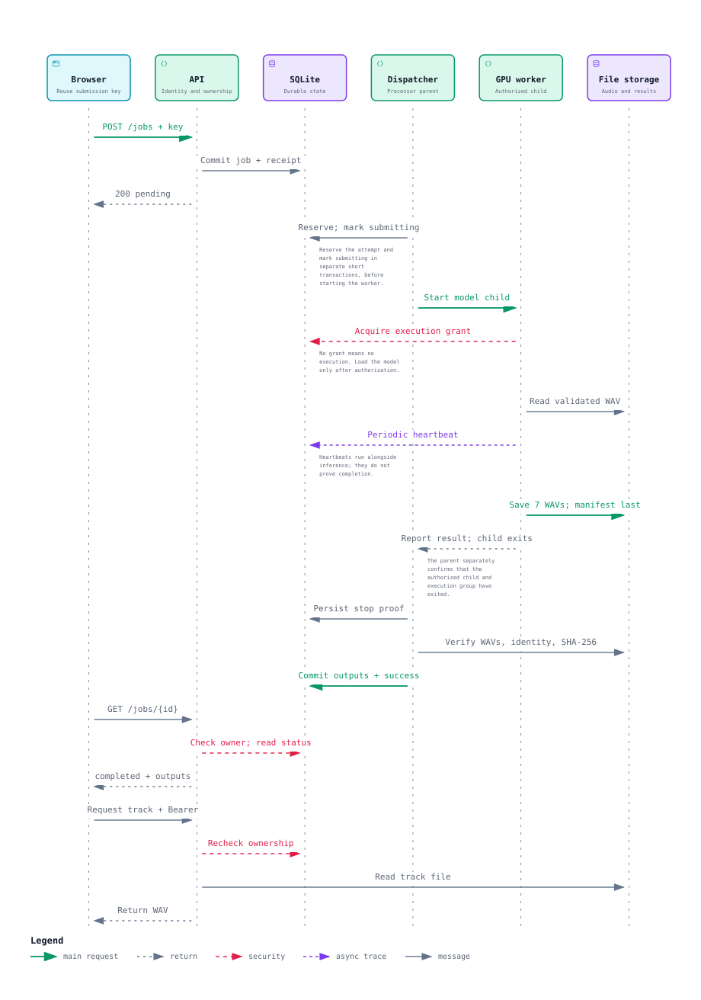
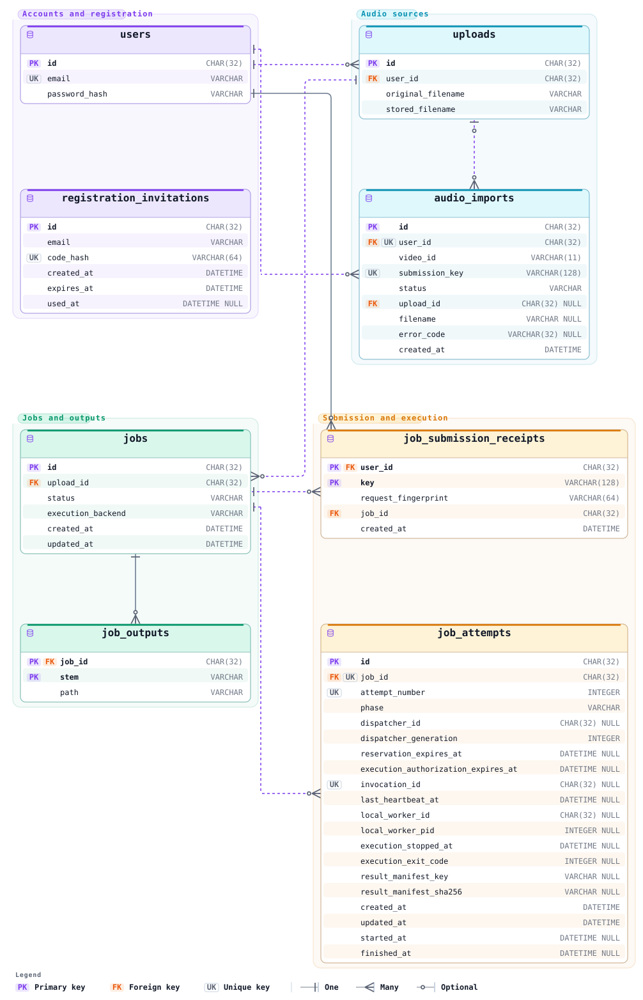

# Architecture

These diagrams describe IsoJam's implemented, single-host `queued` mode. The
API, CPU audio importer and GPU processor run as separate Docker Compose
services, sharing SQLite and local audio storage. They do not represent a
multi-host deployment or a publicly hosted service.

## System overview


The API commits accepted work to SQLite. The importer prepares YouTube audio;
the processor discovers separation jobs in the database and runs one inference
at a time. The API does not call a remote GPU service. The processor contains
a CPU dispatcher and a GPU child process created for each job.

The data volume holds the database, uploads and results. Model assets live in a
separate volume mounted read-only by the processor. Database migration and model
preparation are one-off Compose tasks, outside the three long-running services.

[Interactive HTML](system-overview.html) ·
[Editable Archify source](sources/system-overview.architecture.json)

## Job execution



The sequence starts with a validated upload owned by the signed-in user.
Vertical position expresses ordering, not measured elapsed time. Reservation
and transition to `submitting` use separate short transactions before starting
the worker; execution authorization is another operation.

Job creation and its idempotency receipt commit together. Completion publishes
the seven output records and successful job/attempt states atomically, after
confirmed worker exit and result verification. Saved valid results can recover
from publication failure without repeating inference. Uncertain execution
requires inspection rather than automatic re-execution.

[Interactive HTML](job-execution.html) ·
[Editable Archify source](sources/job-execution.sequence.json) ·
[Worker operation and recovery](../model-worker.md)

## Database schema



The ERD includes all eight physical tables and all 56 columns from the current
SQLAlchemy models, using SQLite types. A `NULL` suffix marks a nullable column;
other columns are required. Relationship lines run from the child holding the
foreign key to its referenced parent.

- `jobs` represents requested work; `job_attempts` records execution attempts.
- `job_submission_receipts` uses the composite primary key `(user_id, key)`.
  The request fingerprint detects reuse of a key with different input.
- `job_outputs` uses the composite primary key `(job_id, stem)`.
- `audio_imports` has a composite unique constraint on
  `(user_id, submission_key)`.
- `job_attempts` has a composite unique constraint on
  `(job_id, attempt_number)` and a separate unique `invocation_id`.

PK and UK badges mark members of a constraint; they do not imply that every
marked column is individually unique. `audio_imports.upload_id` is nullable;
neither it nor `job_submission_receipts.job_id` has a unique constraint.
Invitation emails are checked by application logic and have no foreign key to
`users`. The application verifies that all seven output tracks exist; the schema
does not enforce an exactly-seven-rows rule.

[Interactive HTML](database-schema.html) ·
[Editable Archify source](sources/database-schema.erd.json) ·
[SQLAlchemy models](../../backend/app/db_models.py)

## Viewing and updating

GitHub renders the SVG previews above. To use the interactive reader, clone the
repository or download an HTML file and open it locally. Each HTML file contains
its own viewer and fonts; it needs no application server. GitHub's file view
displays HTML source rather than running the reader.

The JSON files are the editable diagram sources. They pin repository evidence
to commit [`0b202f9`](https://github.com/Ian0520/isojam/commit/0b202f9bfdd82f0040c4ba1194ca69d9d86cf1c5).
Their source paths and line ranges are relative to this repository. Update that
revision and the affected references when changing the documented behavior.

Generated with [Archify v3.2.0](https://github.com/tt-a1i/archify/tree/v3.2.0).
With that version installed, set `ARCHIFY_CLI` to its `bin/archify.mjs`, then run
from the repository root:

```bash
node "$ARCHIFY_CLI" finalize architecture \
  docs/architecture/sources/system-overview.architecture.json \
  docs/architecture/system-overview.html \
  --repo-root . --quality showcase \
  --out-dir docs/architecture/.checks/system-overview --json

node "$ARCHIFY_CLI" finalize sequence \
  docs/architecture/sources/job-execution.sequence.json \
  docs/architecture/job-execution.html \
  --repo-root . --quality showcase \
  --out-dir docs/architecture/.checks/job-execution --json

node "$ARCHIFY_CLI" finalize erd \
  docs/architecture/sources/database-schema.erd.json \
  docs/architecture/database-schema.html \
  --repo-root . --quality standard \
  --out-dir docs/architecture/.checks/database-schema --json

python3 docs/architecture/export_static.py
```

Run finalization commands sequentially. If an edited diagram already has browser
evidence, use a fresh check directory such as `.checks/system-overview-2`.
Local validation receipts are ignored by Git. The export script extracts a
complete static SVG and its styles from each finalized HTML file without
executing JavaScript. Keep source, HTML and SVG changes together.

The embedded Archify viewer is covered by [its MIT license](ARCHIFY-LICENSE.txt).
Bundled font notices are preserved in the generated HTML and SVG files.
