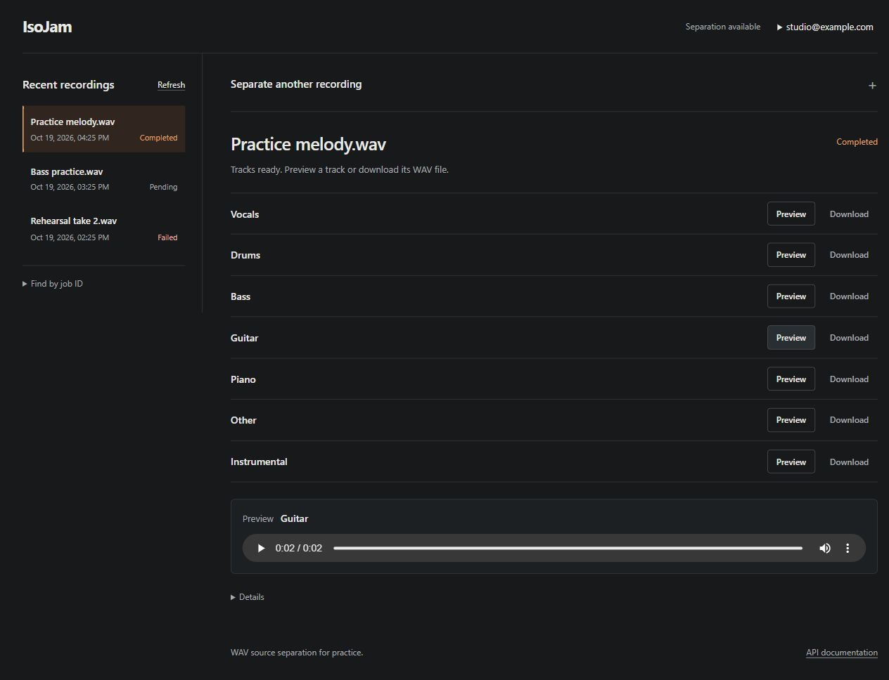

# Browser workflow and demo evidence

For local use, follow the [Docker Compose quickstart](../README.md#start-locally-with-docker-compose).
It starts a CPU API and a separate real GPU processor on the same host. Neither
that stack nor the alternative native setup is a public hosted service.

## Current interface

[Current mobile screenshot](screenshots/workspace-mobile.png).

These screenshots show the current interface with a throwaway account, seeded
recording history and generated two-second tone WAVs. They demonstrate layout,
status display and authenticated preview, not real separation or audio quality.
No personal accounts or recordings were used. The older real-GPU evidence below
is preserved separately.

## Try the browser workflow

1. Start the stack using the README. Open `http://localhost:8000/`, or the port
   configured in `.env`. The example opens registration for local account creation.
2. Select **Create account** and enter an email/password, or use **Sign in**.
   Registration signs in automatically. If login fails after account creation,
   use the created account to retry sign-in rather than registering again.
3. Choose a short WAV you have permission to use and select **Separate audio**.
   The upload form collapses and the selected recording shows queued/processing
   status. The API reports states, not numeric progress, so the page displays no
   invented percentage.
4. When completed, use **Preview** or **Download** beside a track. The player
   appears below the seven tracks. **Details** reveals the job ID and a manual
   status refresh.
5. Reopen work from **Recent recordings**. **Load more** appends another history
   page; **Refresh** returns to the newest page. **Find by job ID** is an expandable
   fallback. The account must own the recording. Reloading restores an acknowledged
   selected job while the tab's sign-in remains valid.
6. Use **Separate another recording** to expand the upload form. It becomes
   usable after the active recording finishes. Sign out through the email menu
   in the header. Submitted jobs continue independently of the browser.

In Compose, model assets are prepared explicitly before startup and verified by
the processor. Its real worker loads the model for each job. Native `local` mode
instead loads a model session during API startup; see the
[alternative native setup](configuration.md#setup). The CPU image alone has no
model. Queued mode accepts jobs; the worker adapter determines whether outputs
come from real `local-model` inference or the explicit `local-fake` test worker.

## Workspace and cache checks (2026-10-19)

During the frontend change, 18 Node authentication/history tests and 13 Python
web-route/cache tests passed. Isolated browser checks exercised empty and populated
accounts, upload/processing/completion, seven track rows, authenticated preview
and download, sign-out, selected-job restoration and narrow-screen filenames.

A separate cache regression check first loaded the earlier release with cached
JavaScript/CSS, then served the newer HTML. It reproduced
`Cannot set properties of null (setting 'hidden')`. With versioned asset URLs and
revalidation headers, an ordinary reload restored the recording and all seven
tracks without that error. HTTP tests cover cache headers on both 200 and 304
responses. These are frontend/integration checks, not new GPU throughput results.

The current screenshots were captured on 2026-10-19 at desktop and 390-pixel mobile
viewport overrides. No horizontal document overflow appeared in the mobile check.
Their temporary API, SQLite data and synthetic audio are separate from personal
Compose volumes.

## Recorded real-GPU demo (earlier interface)

[Watch the local GPU browser recording](demo/real-separation.webm).

The approximately 14-second recording has no audio. It uses a throwaway account
and an original synthetic melody, with real BS-RoFormer inference. It shows the
earlier green interface and its older labels. Preserve it as processing evidence;
use the current screenshots and workflow above for today's interface.

[Original desktop screenshot](screenshots/studio.png) ·
[Original mobile screenshot](screenshots/studio-mobile.png).

## Verification from the original recorded demo

These results belong to the original recorded run and are not a count of the
current test suite. Later Compose/GPU checks are recorded in the
[local stack guide](local-stack.md#verification-recorded-on-2026-10-18).

| Check | Observed result |
| --- | --- |
| Locked CPU suite | 1,064 pytest tests passed, with lint and formatting checks on 88 maintained Python files. |
| Disabled container | Migrations, authentication, owner-only access, packaged browser assets and persistence passed. |
| Queued container | Fake bundle hashes, interrupted publication, API replacement and publication-only recovery passed. |
| Isolated browser checks | 12 flows passed with no JavaScript page errors. |
| Real GPU browser flow | Upload, completion, authenticated preview, all seven downloads and reload restoration passed. |
| Output validation | All seven downloads matched the stored files byte-for-byte and decoded to nonempty, finite audio. |

The browser checks covered signup/login, WAV MIME normalization, a lost job
submission response followed by same-key retry, a truncated accepted JSON response
followed by same-key retry, seven output rows, protected playback/download, reload restoration, mobile layout, signout during a delayed
audio response, cross-account denial, malformed WAV rejection and expired-token
cleanup. These were separate local automation checks; CI currently runs Python
checks, JavaScript syntax, history-controller tests and container HTTP smokes,
not the full browser suite.

The lost-response check dropped the reply **after** the API accepted the job.
A separate truncated-response check returned an incomplete successful JSON reply.
Retrying with the original upload ID and idempotency key returned that same job.
The page retains this retry state while it stays open; it does not persist an
unacknowledged submission across a reload. Save an acknowledged job ID to return
later. Server-side idempotency receipts persist independently of the browser.

### Job-history checks (2026-10-16)

The history list was checked against a disposable queued API with 25 seeded jobs,
a separate initially empty account, and synthetic WAVs. This exercised:

- A 20-item first page, appending the final five items, hiding Load more at the
  end, and refreshing back to the newest page.
- Opening seven output rows from history, authenticated preview/download,
  keyboard activation, the expandable saved-ID lookup, and reload restoration.
- Displaying filenames containing markup characters as literal text.
- Keeping displayed items after an injected 503 and recovering on retry.
- Signing out and entering another account while the old response was delayed;
  the first account's rows stayed cleared after its response arrived.
- Automatically adding a newly submitted synthetic recording to history.
- Clearing history and the selected session on an injected 401, then reopening
  previous work after sign-in.
- No horizontal document overflow with a 390-pixel viewport override.

Nine Node controller tests also cover pagination, retry, competing refreshes,
account-reset races, and status updates. They now run in CI. These checks validate
the browser/history flow; the fixture does not perform real model inference.
At that checkpoint Docker was unavailable in WSL, so the container build was not
rerun locally. Subsequent builds and real GPU container/Compose verification are
recorded in the local stack guide linked above.

## One measured local run

Environment: Ubuntu under WSL2, Python 3.12.3, NVIDIA RTX 4060 Laptop GPU (8 GB),
existing BS-RoFormer session, and a fresh disposable SQLite database.

| Measurement | Observation |
| --- | --- |
| Input | 4 seconds, 44.1 kHz, mono synthetic melody; 352,844 bytes. |
| Warm browser completion | 6.492 seconds from submission through displayed completion. |
| Outputs | Seven 4-second mono float32 WAVs at 44.1 kHz; 705,680 bytes each. |
| Output storage | 4,939,760 bytes total, approximately 4.71 MiB. |
| Local API resident memory after the run | Approximately 2.46 GiB with the GPU model loaded. |

This is a single integration observation. The completion time includes browser,
upload, job submission and polling overhead; it excludes cold model startup.
Resident process memory is not GPU VRAM usage or a cloud sizing recommendation.
The synthetic input proves the integration and output format, not separation
quality. The [earlier model spike](model-spike.md) records separate, subjective
quality observations on music and longer-track timings.

Input and generated audio remain outside Git. Only screenshots and a silent
screen recording are committed. The new interface screenshots use separate
synthetic preview fixtures, as described above. See [operations](operations.md) for diagnostic
commands and the current recovery limits.
