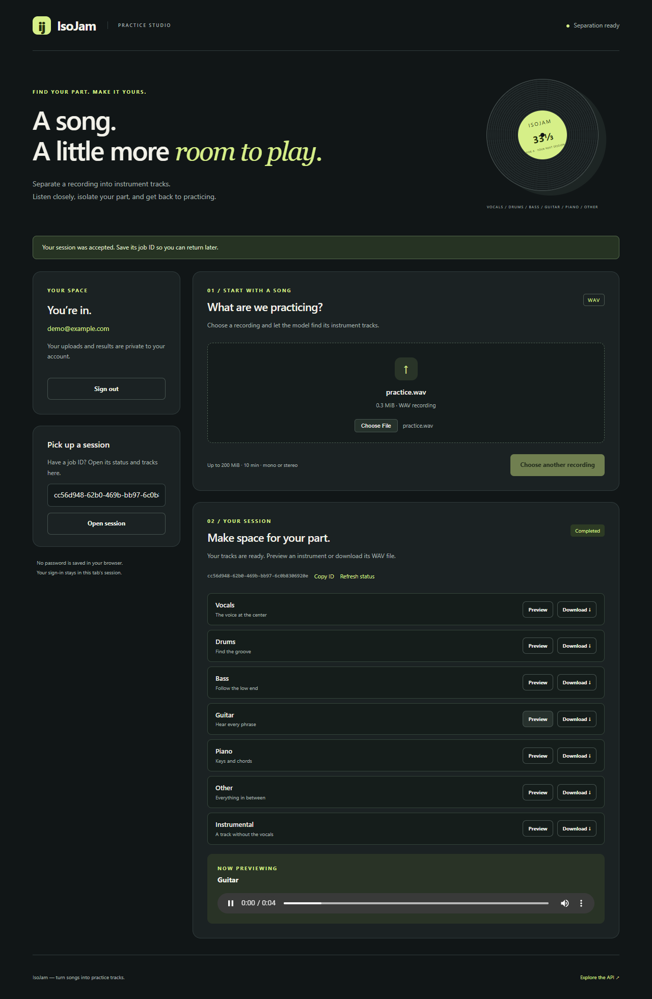

# Browser demo and verification evidence

The browser studio supports a complete **local GPU** flow: create an account,
upload a WAV, submit a job, poll its status, preview a stem and download all seven
outputs. It also includes a separate CPU container exercise for queued fake work
and recovery. Neither path is currently deployed as a public service.

## Recorded demo

[Watch the local GPU browser recording](demo/real-separation.webm).

The recording is approximately 14 seconds and contains video only. It uses a
throwaway account and an original synthetic melody rather than a commercial
recording. The screenshots below show the real completed model job, not the fake
queued worker.

[Mobile screenshot](screenshots/studio-mobile.png).

## Run your own demo

1. Follow [local GPU setup](configuration.md#setup): install the inference extra,
   use a compatible CUDA-enabled PyTorch environment, configure the JWT secret,
   and run `alembic upgrade head` against the selected database.
2. From `backend`, activate the environment, set `ISOJAM_PROCESSING_MODE=local`
   and `ISOJAM_REGISTRATION_MODE=open` for local account creation, then run
   `uvicorn app.main:app --host 127.0.0.1 --port 8000`.
3. Open `http://127.0.0.1:8000/`. Create an account or sign in.
4. Choose a short WAV you have permission to use, then select **Separate audio**.
   Watch pending/processing become completed. The page displays no invented
   percentage because the API reports state rather than numeric progress.
5. Preview an instrument and download its WAV. Reload the page to restore the
   selected session, or select previous work from **Your sessions**. **Load more**
   appends another history page; **Refresh** returns to the newest page. Saved
   job IDs can also be entered in the expandable lookup. The same account must
   own the job.
6. Sign out. The browser removes its tab-scoped token and audio URLs; accepted
   server jobs continue independently of the browser.

The first model startup may download weights and takes longer than a warm job.
The CPU image has no model; running it alone will not separate your music.
In `queued` mode, the browser labels the outputs as demonstration audio and a
separate `python -m app.dispatcher --once --adapter local-fake` cycle is required.

## Verification results

| Check | Observed result |
| --- | --- |
| Locked CPU suite | 1,064 pytest tests passed, with lint and formatting checks on 88 maintained Python files. |
| Disabled container | Migrations, authentication, owner-only access, packaged browser assets and persistence passed. |
| Queued container | Fake bundle hashes, interrupted publication, API replacement and publication-only recovery passed. |
| Isolated browser checks | 12 flows passed with no JavaScript page errors. |
| Real GPU browser flow | Upload, completion, authenticated preview, all seven downloads and reload restoration passed. |
| Output validation | All seven downloads matched the stored files byte-for-byte and decoded to nonempty, finite audio. |

The browser checks covered signup/login, WAV MIME normalization, a lost job
submission response followed by same-key retry, a truncated accepted JSON response
followed by same-key retry, seven output rows, protected playback/download, reload restoration, mobile layout, signout during a delayed
audio response, cross-account denial, malformed WAV rejection and expired-token
cleanup. These were separate local automation checks; CI currently runs Python
checks, JavaScript syntax, history-controller tests and container HTTP smokes,
not the full browser suite.

The lost-response check dropped the reply **after** the API accepted the job.
A separate truncated-response check returned an incomplete successful JSON reply.
Retrying with the original upload ID and idempotency key returned that same job.
The page retains this retry state while it stays open; it does not persist an
unacknowledged submission across a reload. Save an acknowledged job ID to return
later. Server-side idempotency receipts persist independently of the browser.

### Job-history checks (2026-10-16)

The history list was checked against a disposable queued API with 25 seeded jobs,
a separate initially empty account, and synthetic WAVs. This exercised:

- A 20-item first page, appending the final five items, hiding Load more at the
  end, and refreshing back to the newest page.
- Opening seven output rows from history, authenticated preview/download,
  keyboard activation, the expandable saved-ID lookup, and reload restoration.
- Displaying filenames containing markup characters as literal text.
- Keeping displayed items after an injected 503 and recovering on retry.
- Signing out and entering another account while the old response was delayed;
  the first account's rows stayed cleared after its response arrived.
- Automatically adding a newly submitted synthetic recording to history.
- Clearing history and the selected session on an injected 401, then reopening
  previous work after sign-in.
- No horizontal document overflow with a 390-pixel viewport override.

Nine Node controller tests also cover pagination, retry, competing refreshes,
account-reset races, and status updates. They now run in CI. These checks validate
the browser/history flow; the fixture does not perform real model inference.
The container build could not be rerun locally because Docker was unavailable in
WSL; the updated asset smoke and existing container checks remain part of CI.

## One measured local run

Environment: Ubuntu under WSL2, Python 3.12.3, NVIDIA RTX 4060 Laptop GPU (8 GB),
existing BS-RoFormer session, and a fresh disposable SQLite database.

| Measurement | Observation |
| --- | --- |
| Input | 4 seconds, 44.1 kHz, mono synthetic melody; 352,844 bytes. |
| Warm browser completion | 6.492 seconds from submission through displayed completion. |
| Outputs | Seven 4-second mono float32 WAVs at 44.1 kHz; 705,680 bytes each. |
| Output storage | 4,939,760 bytes total, approximately 4.71 MiB. |
| Local API resident memory after the run | Approximately 2.46 GiB with the GPU model loaded. |

This is a single integration observation. The completion time includes browser,
upload, job submission and polling overhead; it excludes cold model startup.
Resident process memory is not GPU VRAM usage or a cloud sizing recommendation.
The synthetic input proves the integration and output format, not separation
quality. The [earlier model spike](model-spike.md) records separate, subjective
quality observations on music and longer-track timings.

Input and generated audio remain outside Git. Only screenshots and a silent
screen recording are committed. See [operations](operations.md) for diagnostic
commands and the current recovery limits.
